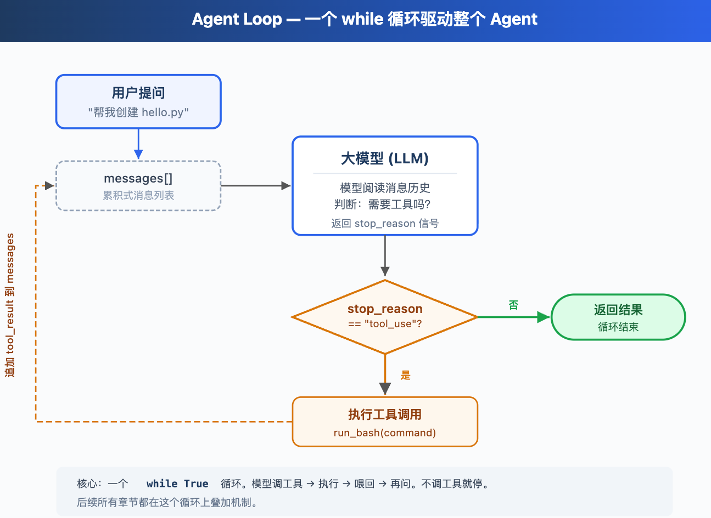

# agent loop

使用循环，让模型与真实世界之间建立连接。

（一个循环驱动整个Agent）

## 1.存在问题

和模型进行对话，模型并不会主动的去使用工具，它只会告诉你工具怎么用，你可以把工具的输出结果贴给他，然后再让它根据输出结果再输出。



循环驱动的Agent，当stop_reason等于tool_use时，代表模型想要使用工具，那么此时就需要执行，然后将工具调用结果返回给模型，然后继续执行，反之，stop_reason不等于tool_use时，等于模型告诉用户已经执行完成，那么此时就需要退出循环。

这里只说核心步骤，首先就是定义工具函数描述，TOOLS，它有专门的字段描述，然后实现具体的工具函数，记住工具函数和TOOLS中字段描述name的对应关系。其次，就是实现Agent的核心循环。

核心循环的实现：首先要接受大模型的输出结果response，其次，提取出大模型的响应内容，然后是将assistant消息添加到messages之中，便于下一次循环时告诉大模型上一步执行的结果。处理完消息队列之后，就需要开始处理工具调用，在当前循环之中，依次遍历tool_calls，然后判断对应哪个工具，紧接着调用对应的工具函数就行。

```python
import json
import os
import subprocess

from dotenv import load_dotenv
from openai import OpenAI

try:
    import readline

    # macOS 的 libedit 在处理中文输入时有退格问题，这四行修复它
    readline.parse_and_bind("set bind-tty-special-chars off")
    readline.parse_and_bind("set input-meta on")
    readline.parse_and_bind("set output-meta on")
    readline.parse_and_bind("set convert-meta off")
except ImportError:
    pass


load_dotenv()

client = OpenAI(
    api_key=os.getenv("API_KEY", "API_KEY"),
    base_url=os.getenv("BASE_URL", "BASE_URL"),
)

print("当前 Base URL:", client.base_url)
print("当前os:", os.getenv("BASE_URL"))
SYSTEM = f"You are a coding agent at {os.getcwd()}. Use bash to solve tasks. Act ,don't explain."
TOOLS = [
    {
        "type": "function",
        "function": {
            "name": "bash",
            "description": "Run a shell command.",
            "parameters": {
                "type": "object",
                "properties": {"command": {"type": "string"}},
                "required": ["command"],
            },
        },
    }
]


def run_bash(command: str) -> str:
    """
    工具执行逻辑
    """
    dangerous = ["rm -rf /", "sudo", "shutdown", "reboot", "> /dev/"]
    if any(d in command for d in dangerous):
        return "Error: Dangerous command blocked."
    try:
        r = subprocess.run(
            command,
            shell=True,
            cwd=os.getcwd(),
            capture_output=True,
            text=True,
            timeout=120,
            check=False,
        )
        out = (r.stdout + r.stderr).strip()
        return out[:5000] if out else "(no output)"
    except subprocess.TimeoutExpired:
        return "error:timeout 120s"
    except (FileNotFoundError, OSError):
        return "file error"


def agent_loop(messages: list):
    """
    agent核心循环
    """
    if not messages:
        return "message is none"
    while True:
        # 得到大模型响应结果
        response = client.chat.completions.create(
            model=os.getenv("MODEL_NAME", "MODEL_NAME"),
            messages=[  # type:ignore
                {"role": "system", "content": SYSTEM},
            ]
            + messages,
            tools=TOOLS,  # type:ignore
            max_tokens=8000,
        )
        # 提取响应内容message
        msg = response.choices[0].message
        # 得到工具使用
        tool_calls = msg.tool_calls or []
        # 如果不使用工具就退出
        if not tool_calls:
            return
        print(f"[tool_calls]:{tool_calls}")
        # 将工具使用添加到messages之中，便于下一次循环使用
        assistant_msg = {"role": "assistant", "content": msg.content or ""}
        if tool_calls:
            assistant_msg["tool_calls"] = [  # type:ignore
                {
                    "id": tc.id,
                    "type": "function",
                    "function": {
                        "name": tc.function.name,  # type:ignore
                        "arguments": tc.function.arguments,  # type:ignore
                    },
                }
                for tc in tool_calls
            ]
        messages.append(assistant_msg)
        # 循环遍历工具使用列表
        for tc in tool_calls:
            if tc.function.name == "bash":  # 找到对应的bash-tool   # type:ignore
                args = json.loads(tc.function.arguments)  # type:ignore
                # 执行工具使用
                command = args["command"]
                output = run_bash(command)
                print(output)
                # 消息添加
                messages.append(
                    {
                        "role": "tool",
                        "tool_call_id": tc.id,
                        "content": output,
                    }
                )
```


